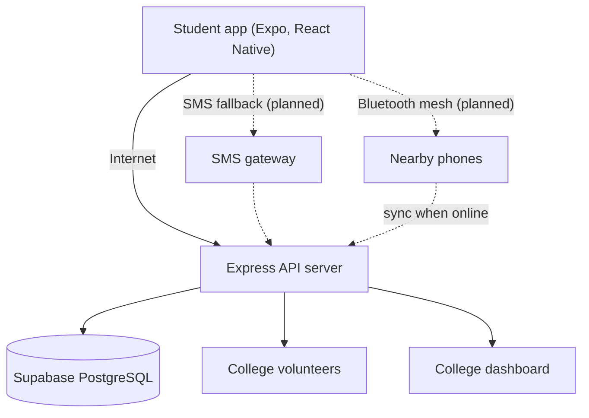
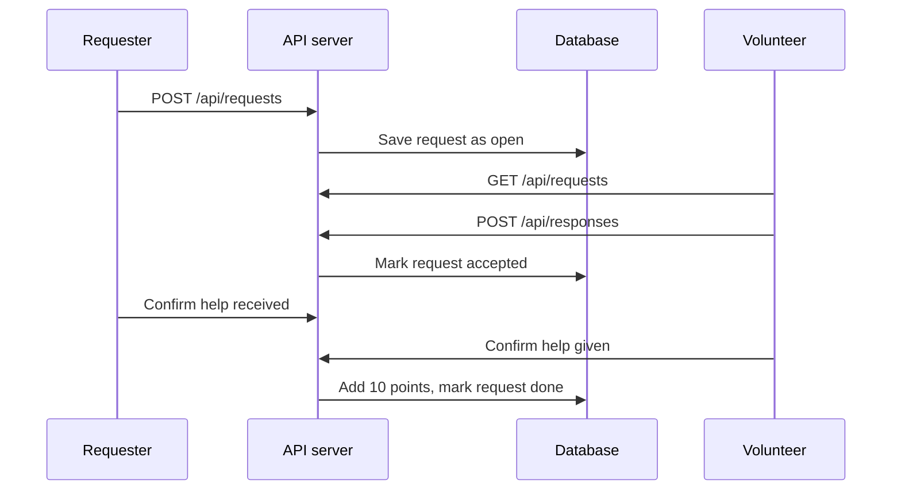

# Sakhinet Technical Design

## 1. Problem

Girls often need a pad or help with period cramps in places where nothing is available: classrooms, buses, bus stands and hostels. Asking in person is embarrassing, shops are far, and dispensers are often empty. Sakhinet connects verified students of the same college so help arrives within minutes, anonymously.

## 2. System architecture

Solid lines are implemented. Dashed lines are planned.

## 3. Request flow

## 4. Components

- Mobile app: screens for help, washrooms and rewards. Sends requests and lists open ones.
- API server: Express routes for requests, users, responses, washrooms, rewards and dashboard. Every query is filtered by college_id so one college never sees another's data.
- Database: Supabase PostgreSQL.

## 5. Database design

| Table | Purpose |
|---|---|
| colleges | One row per school or college |
| users | Students and volunteers, with points |
| requests | Help requests (type pad or cramps, status, route used, expiry) |
| responses | A volunteer accepting a request, with two confirmation flags |
| points_log | Record of every points award |
| washrooms | Washrooms with water, dustbin, lock, pads, rating |
| reports | Problem reports about washrooms |
| dispensers | Dispenser locations and stock level |

Request status moves from open to accepted to done.

## 6. Key design decisions

- Anonymity: a request shows only a location note such as "Near Block C", never a name or photo.
- Trust: communities are separated by college_id. Verification by college ID or email domain is planned.
- Anti-cheat rewards: points are given only when both the requester and the volunteer confirm. Users cannot accept their own request, and a request can be accepted only while open.
- Offline layers: the app is designed to try internet first, then SMS, then Bluetooth mesh. Only the internet layer is built.

## 7. Test cases

| ID | Case | Expected result |
|---|---|---|
| T1 | GET /api/health | Status ok |
| T2 | Create a request with a valid college_id | 201 and status open |
| T3 | Create a request without college_id | 400 error |
| T4 | List open requests for a college | Array containing the new request |
| T5 | Volunteer accepts an open request | 201 and request status accepted |
| T6 | Accept an already accepted request | 400 error |
| T7 | Both sides confirm | Response completed, volunteer gets 10 points |
| T8 | List washrooms with has_dustbin=true | Only washrooms with a dustbin |
| T9 | Leaderboard | Users sorted by points with badges |
| T10 | Dashboard | Totals grouped by status, type, route and location |

## 8. Limitations and next steps

- Add authentication and college verification, and turn on row level security.
- Build the SMS fallback and the Bluetooth mesh layer.
- Add the offline washroom map and the private pain tracker on the phone.
- Add fake-request protection with daily limits and moderator tools.